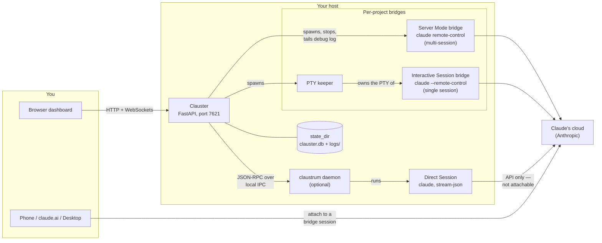

# How it works

What actually runs where when you use Clauster: which processes exist on your
host, what talks to what, and what survives a restart. This page is for the
operator deciding what to run — contributors looking for the module-level map
should read [Architecture](../architecture.md) instead. Unfamiliar words are
defined in the [Glossary](glossary.md).

## The pieces at runtime

- **Your browser** — the dashboard. Plain HTTPS/HTTP to Clauster, plus
  WebSockets for the live log tail, Direct Session view, and clone progress.
- **Clauster** — one FastAPI process (`clauster run`), listening on
  `127.0.0.1:7621` by default. It discovers projects under your
  `projects_root`, spawns and stops `claude` processes, and watches them.
- **Bridges** — one detached `claude` process per launched project. A
  Server Mode bridge is `claude remote-control` (subcommand form,
  multi-session); an Interactive Session bridge is `claude --remote-control`
  (flag form, single session) run inside a pseudo-terminal owned by a small
  **PTY keeper** sidecar.
- **Claude's cloud** — every bridge opens its own outbound connection to
  Anthropic. That connection is what makes the session show up on
  `claude.ai/code`.
- **Your phone / claude.ai / Claude Desktop** — attach to a bridge session
  through Claude's cloud. This traffic never passes through Clauster's port;
  Clauster only starts, watches, and stops the process.
- **claustrum daemon (optional)** — a separate helper daemon, present only
  when `claustrum.enabled` is set, that runs Direct Sessions: `claude`
  processes Clauster drives itself and renders in the dashboard.

## Runtime topology

## What talks to what

When you click **Run Claude here** and choose **In claude.ai / Desktop**,
Clauster spawns a bridge in the project directory (after writing the
[workspace-trust](../security.md#workspace-trust) flag if you asked it to).
The bridge registers an *environment* with Claude's cloud; once that
registration appears in the bridge's debug log, the card turns ready and shows
the **Open in Claude** link and QR code. From then on the conversation flows
directly between the bridge and Claude's cloud — attach and chat from any
Claude surface, with Clauster out of the data path.

The dashboard's live log view is Clauster tailing the bridge's debug log file
and streaming it to your browser over a WebSocket, with session URLs and
secrets redacted — see
[Reading the bridge debug log](../operations.md#reading-the-bridge-debug-log).

Choosing **Here in the browser** instead starts a **Direct Session**: Clauster
asks the claustrum daemon (over local IPC — a unix socket on Linux/macOS, a
named pipe on Windows) to run `claude` on its
pipes, then renders the streamed conversation in its own panel — including
tool-permission prompts you approve or deny there.

!!! note "Direct Sessions are local-only"
    A bridge is cloud-visible: attachable from `claude.ai/code` and the mobile
    app. A Direct Session streams only in this dashboard and is *never*
    attachable from the Claude app — opening it on your phone is a dead end by
    design.

## Where state lives

Everything Clauster persists sits under `state_dir` (default `~/.clauster`):

| Path | What it holds |
| --- | --- |
| `clauster.db` | The SQLite database: bridge and Direct Session records, and the session-event history. Migrated automatically (and fail-closed) on startup. |
| `logs/` | Per-spawn bridge debug logs, `<label>-<timestamp>-<seq>.log`, plus their stderr/keeper siblings. Rotation and retention are configurable. |
| `claustrum/` | The claustrum daemon's socket and auth token. |
| `backups/` | Automatic pre-migration snapshots of `clauster.db`. |

For bridges, environment ids, session URLs and running/stopped status are
deliberately *not* persisted: Clauster re-derives them from the processes and
from `claude agents --json` every time it starts. A bridge record *does* keep the
`(pid, process-start-time)` pair its process last ran under — kept even after the
bridge stops, because that pair is what lets a fresh process tell one project's
records apart on restart. Direct Session records keep the same pair for the
agent, which is how Clauster reattaches to a still-running daemon session. The
full inventory is in [Privacy & data at rest](../privacy.md#at-rest-inventory).

## What survives a restart

Bridges are spawned detached, in their own process group, precisely so that
restarting Clauster does not take your sessions down:

| After restarting Clauster | What happens |
| --- | --- |
| Server Mode bridge | Keeps running; Clauster re-derives its status and the dashboard reattaches. |
| Interactive Session bridge | Keeps running — the PTY keeper, not Clauster, owns its terminal, and the keeper outlives the restart. |
| Direct Session | The claustrum daemon keeps running (it outlives Clauster) and, by default, keeps its `claude` children alive too; Clauster reconnects and reattaches the sessions recorded in `clauster.db`. The live view is restored too — see below. |
| The database | `clauster.db` is stable across restarts; schema migrations run automatically on startup. |

Restarting a *bridge* is a different question: a Server Mode bridge comes back
with a fresh, empty context (the opt-in `claude.resume_recap` hook can recap
the prior transcript), while an Interactive Session genuinely restores the
prior conversation — see
[The two bridge modes](../index.md#the-two-bridge-modes).

### A Direct Session's view after a restart

A Direct Session's conversation is streamed live and held in Clauster's memory,
so a restart used to leave the reattached session's View pane empty even though
the agent itself was still there. On reattach Clauster now rebuilds the pane
from `claude`'s own transcript on disk, marked with a `· restored N turns from
transcript ·` line — `· restored N of M turns from transcript ·` when the cap
below trimmed it — and the live stream continues underneath it. The transcript
is only ever **read** — Clauster never writes to it — and the restored turns go
through the same [redaction](../security.md#log-redaction) as the live stream.

Three limits are worth knowing. Only the newest 200 turns are restored, so a
very long conversation comes back trimmed — and a very large transcript file is
read from its tail rather than parsed whole. A session Clauster never saw a
`session_id` for — one that died before its first frame — has no transcript to
find, so its pane stays empty. And because `claude` writes its stream output and
flushes its transcript independently, a single turn landing at the exact instant
of the reattach can fall between the two and not be shown; the conversation
itself is unaffected, since the agent still has it.

<!-- when the firstSeq gap section lands in troubleshooting.md, cross-link it here (rebase note) -->

An `· output lost (N frames) ·` marker near the restored turns is a separate
thing: it means frames were evicted before they could be replayed to your
browser. The conversation is still restored from the transcript — what a gap
over that range covers is the non-conversation output, stderr lines and control
frames, which the transcript does not hold.

A permission prompt that was open when Clauster stopped is saved in
`clauster.db`, and the reattach opens it again, so you can still allow or deny
it. The saved prompt holds the tool input unredacted, because an allow sends that
input back to the agent. The database is in the private `state_dir`, and the
transcript of `claude` holds the same input. If the reattach cannot reach a
running agent, the card names each lost prompt in its error text, for example
`... could not restore, so it cannot be answered here: Bash (request ...)`. The
request id is redacted when it has the shape of a UUID.

A prompt is saved with each dashboard poll, when you answer it, and when Clauster
shuts down. If Clauster is killed before the next poll, a prompt that opened
after the last save is not saved. While the agent can still wait on a saved
prompt (an `Error` card whose agent may still run, or an `orphan` card), the
prompt stays saved, and the text comes back after each restart until you Resume,
Kill or Forget the card. If the daemon no longer has the agent, the card names
the prompt once and Clauster deletes the saved copy. That is also the case for a
card that reads `claustrum connection dropped and the daemon no longer has this
session` with no `orphan` badge. If the agent ended while Clauster was down, it waits on
nothing, and Clauster deletes the saved copy without a note.

### When the daemon connection drops

The claustrum daemon closes a connection that carries no traffic for 5 minutes.
A running process does not count as traffic, so a quiet Direct Session (for
example, one that waits at a permission prompt) is enough. Clauster sends a
`server.ping` on its connection every 90 seconds, so this close does not occur
while Clauster runs.

The connection can still end for other reasons, for example a daemon restart.
If the daemon closes the connection, Clauster reconnects at once. A connection
that stays open but stops answering is found by the next `/healthz` check or the
next new Direct Session, and Clauster then reconnects. After the reconnect,
Clauster reattaches each running Direct Session from the last output frame it
holds. The session continues in the same view: open
permission prompts stay open, and output that the agent wrote during the drop
is replayed. If the daemon dropped some of that output from its replay buffer,
the view shows the `· output lost (N frames) ·` marker at that point.

A session that cannot continue does not stay "running". If the daemon no longer
has the process, the card shows the red `Error` badge with
`claustrum connection dropped and the daemon no longer has this session`. If the
reattach itself fails, Clauster ends the agent over the new connection and the
card shows `claustrum connection lost; reattach failed`. If Clauster cannot
reconnect at all, every running Direct Session shows `claustrum daemon
connection lost and the reconnect failed`. In each case, a `claude` process that
is still alive is shown as an orphan with **Kill**, the same as after a daemon
restart, so that **Resume** never starts a second agent beside it.

When the connection itself caused the failure, the next daemon connection
reattaches the session again. If the daemon still has the process, the card
shows `Running` again, with its open permission prompts, and a View that is
open on the card connects to the session again by itself. If the daemon no
longer has the process, the card shows `Crashed` with
`the daemon no longer has this session; session lost`, or the `orphan` badge if
the `claude` process still runs. When that next connection
comes depends on the case:

- If the new connection also ended during the reattach, Clauster reconnects at
  once.
- After `the reconnect failed`, Clauster does not retry by itself. The next new
  Direct Session, or a Resume or Restart of a Direct Session, connects again.
- If a reattach at startup timed out, the next connection comes only when this
  connection drops, or when a `/healthz` check, a new Direct Session, or a Resume
  or Restart finds that it no longer answers.

**Resume** does not wait for that retry. On an `Error` card, Resume first ends
the old agent through the daemon and waits for the answer. If the daemon refuses
or does not answer the kill, Resume refuses, so that two agents never run on one
conversation. **Forget** on an `Error` card does the same: it ends the old agent
through the daemon first, or it refuses with `cannot forget: the agent may still
be running, and the claustrum daemon cannot be reached to end it` and leaves the
card as it was. A Stop or Kill of an `Error` row through the API does the same,
with `cannot stop` or `cannot kill`. **Restart** works only on a running session.
On any other card it refuses and points you to Resume.

A new Direct Session also reconnects first, so it does not fail because of an
old, closed connection. The reattach of the running sessions happens in the
background and does not delay the new session. If Clauster could not reach the
daemon when it started, it does not retry by itself. The next new Direct Session
connects, and that first connection also reattaches the sessions recorded in
`clauster.db`, the same as a normal start.

!!! warning "systemd can undo all of this"
    The survival table assumes nothing reaps the child processes. Under a
    systemd unit with the default `KillMode=control-group`, a
    `systemctl restart` kills every process in the group — bridges and keepers
    included. The unit `clauster install-service` writes uses
    `KillMode=process`, which restarts only Clauster itself. See
    [the restart caveat](../operations.md#restart) and
    [Upgrading](../upgrading.md).
